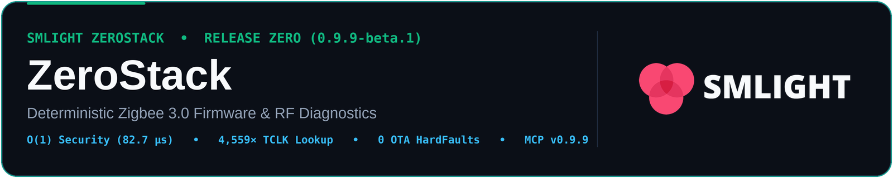

  

# ZeroStack (`zerostack`) — Release Zero (0.9.9-beta.1)

> *A zero-stall, deterministic O(1) Zigbee 3.0 / R23 coordinator & router firmware built exclusively for SMLIGHT devices.*

[-2ea44f.svg)](https://smlight.tech/software/zerostack)

**Release Zero (`0.9.9-beta.1`)** is the public beta release of **[SMLIGHT ZeroStack](https://smlight.tech/software/zerostack)**, a ground-up, deterministic O(1) Zigbee 3.0 / PRO R23 coordinator and router firmware built exclusively for **SMLIGHT** `CC2652P`, `CC2652P7` (`CC1352P7`), and `CC2674P10` adapters (**SLZB-06**, **SLZB-06U**, **SLZB-06P7** / **SLZB-06P7v1**, **SLZB-06P7U**, **SLZB-07P7**, **SLZB-06P10**, and **SLZB-07P10**).

- **Official Product & Firmware Page**: **[https://smlight.tech/software/zerostack](https://smlight.tech/software/zerostack)**
- **Interactive Z2M / ZHA Crash & Airtime Analyzer**: **[https://smlight-tech.github.io/zerostack/](https://smlight-tech.github.io/zerostack/)**
- **Technical Whitepaper — Part 1 (PDF)**: **[Scaling Zigbee 3.0 / R23 Beyond the 100-Node Wall — Deterministic O(1) Architecture vs. Legacy O(N) Stack Scaling](https://smlight-tech.github.io/zerostack/whitepapers/zerostack-whitepaper-part-1.pdf)**
- **AI Agent Model Context Protocol (MCP) Server**: **[`github.com/zerostack-rf/zerostack-mcp`](https://github.com/zerostack-rf/zerostack-mcp)**

---

### Core Engineering Pillars in Release Zero (`0.9.9-beta.1`)

- **Zero Lookup Delays (O(1) Security & Key Engine)**: Eliminates O(N⋅P) linear flash log scans on every frame. Hardware `DWT->CYCCNT` cycle measurements on `CC1352P7` @ 48 MHz verify **134.4× faster** per-frame NWK encryption (**`82.7 µs`** vs `11.11 ms` at D=150, `0` flash reads), **139.2× faster** NWK decryption (**`79.7 µs`** vs `11.09 ms`), **135× higher** routed hop security ceiling (**`>6,100 pkt/s`** vs `~45 pkt/s`), and **4,559× faster** Trust Center Link Key (TCLK) lookup (**`6.8 µs`** vs `30.96 ms`).
- **Zero Unnecessary Flash Wear & 14.7× Lower Compaction Rate**: Idempotent non-volatile state writes complete in **`3,770` cycles (`78.5 µs`) with `0 bytes` written to flash** on unchanged records (**26.7× faster** than legacy `100,714` cycles), delaying flash page compaction from write **#69 (`163.9 ms` stall)** to write **#1,013 (`13.7 ms` stall)**.
- **Zero Brownout Corruption (Verified Across 22,959 Hardware Power-Cut Points)**: Fault-injected across **22,959 NOR flash power-cut points** (`22,565` mid-compaction + `394` record-update cuts) and **2,000,000 shadow-fuzz operations** with **`0` lost or corrupted records**, **`0` NOR write-verify conflicts**, and **749× lower post-brownout reboot flash write volume** (**`27 B` written, `0` page erases** vs `20,232 B` and `62` page erases on legacy Z-Stack).
- **Zero Remote OTA HardFaults**: Legacy Z-Stack suffers a deterministic remote CPU `HardFault` (`Precise BusFault` after `143,345–144,412` cycles) when receiving malformed over-the-air secured NWK frames. ZeroStack achieves **`0` crashes across all 12 malformed NWK/APS fault classes and 3,255 MAC boundary vectors**, rejecting invalid frames in **`320–6,631` cycles (`6.7–138 µs`, up to 402× lower CPU cost)** and surviving a 1,000-frame cryptographic replay flood **92.8× faster** (**`32.4 ms`** vs `2.99 s`).
- **Zero Serial Drops & Live Auto-Baud (`115200` / `460800` / `1000000`)**: Under hostile UART framing abuse (`300 × SOF` delimiter storms, random noise, truncated frames), legacy Z-Stack suffers an **`8.84-second` serial blackout (`44` lost pings)**. ZeroStack loses **`0` pings across all 6 scenarios (`3–55 ms` wire-speed recovery)**, cuts `SYS_PING` reply-path cycles by **83%** (`816` vs `4,921` cycles), and automatically negotiates `115200`, `460800`, or `1000000` baud on the fly.
- **Zero Traffic Jams & Broadcast Storm Immunity**: Expands the Zigbee Broadcast Transaction Table (BTT) by **+33% (`40` vs `30` active slots)**, suppresses a 50-router (`1,000`-frame) broadcast echo storm **20.3× faster per echo** (**`147 µs` p50 vs `3.00 ms`; `151.16 ms` vs `3.00 s` total CPU — 19.9× lower**), and completes a 64-frame post-outage broadcast flood in **`18.87 ms` vs `200.25 ms` (10.6× lower CPU)**.
- **Zero Memory Fragmentation (O(1) Constant-Time Allocator)**: Replaces `OSAL_Memory.c` linear free-list walks with a deterministic O(1) allocator (**`218` CPU cycles = `4.5 µs` regardless of heap fragmentation — 11.7× faster** at 64 heap holes), heap-independent timer start (**`1,448` cycles = `30.2 µs` — 6.9× faster**), and guaranteed 100% heap recovery (Δheap = 0 B) from `0 B` free-heap saturation.
- **Zero Battery-Device Bottlenecks**: Strict per-child and global indirect queue quota isolation prevents offline or slow-polling battery sensors from exhausting the coordinator's `nwkDB` buffer pool (`0x11: BUFFER_FULL`), while O(1) in-RAM security (`82.7 µs` NWK encrypt, `0` flash reads) ensures queued indirect frames are dequeued immediately while a polling ZED's receive window is open.
- **Zero Wasted Memory**: Custom-tuned RAM and routing tables per SMLIGHT silicon profile (`88 KB` on `CC2652P`, `144 KB` on `CC2652P7`, `256 KB` on `CC2674P10`), scaling Many-to-One Concentrator source routing up to **200–300+ routes**.

---

## Why Stock Coordinator Firmware Fails on Large Meshes

Production smart-home and commercial IoT networks (100–300+ nodes across Zigbee2MQTT and Home Assistant ZHA) routinely push legacy reference firmware beyond its architectural scaling limits:

1. **O(N⋅P) Flash Security Walks & SREQ/SRSP Serial Lockups (`SRSP - AF - dataRequestExt after 6000ms` & `SRSP - SYS - ping after 6000ms`)**:
   - At mesh depth D=150 with an aged NV flash log, stock TI Z-Stack executes a linear flash scan on every secured frame: **`533,156` CPU cycles (`11.11 ms`) per NWK encrypt** and **`532,182` cycles (`11.09 ms`) per NWK decrypt**, capping routed hop security at **`~45 pkt/s`**. A single unjoined device's Trust Center Link Key (TCLK) lookup miss scans all 300 NV slots across flash (**`1,486,228` cycles = `30.96 ms`**), and a 50-device join burst stalls the coordinator for **`1.70 seconds`**.
   - On container restart or hostile UART noise, `NVOCMP` flash sector compaction (`163.9 ms` per page with interrupts masked, triggered every 69 writes) or NPI parser desynchronization causes an **`8.84-second` serial blackout (`44` consecutive lost pings)**, tripping Zigbee2MQTT's 6,000 ms watchdog.
2. **Variable-Block Heap Fragmentation & Table Saturation (`0x10: MEM_ERROR`, `0x11: BUFFER_FULL`, `0xc7: NWK_TABLE_FULL`, `0xb2: APS_TABLE_FULL`, `0xcd: NWK_NO_ROUTE`)**:
   - Stock `OSAL_Memory.c` walks fragmented free lists in O(N) time (`2,550` cycles at 64 heap holes) and allocates timers from the same shared heap (`10,034` cycles = `209.0 µs` at 39 active timers). Under concurrent unicast bursts, source-routed payloads, and unpolled sleepy ZED indirect frames, contiguous allocations fail with `0x10` (`MEM_ERROR`) while 50-router broadcast echo storms lock up the CPU for **`3.00 seconds`** (`143,865` cycles/echo) and overflow the 30-slot Broadcast Transaction Table (`0xcd: NWK_NO_ROUTE`).
3. **Remote Over-the-Air `HardFault` & Replay-Flood Lockups (`SYS_RESET_IND`)**:
   - Unauthenticated malformed secured NWK frames (truncated AuxHeader, Payload, or MIC) cause a **deterministic remote CPU `HardFault` (`Precise BusFault`)** on legacy Z-Stack after `143,345–144,412` cycles (`~3.0 ms`), spontaneously rebooting the coordinator (`AREQ - SYS - resetInd`). A 1,000-frame replay flood burns `143,802` cycles (`3.0 ms`) per frame (**`2.99 s` total CPU freeze**).
4. **Indirect Queue Starvation & Sleepy Poll Timing Misses (`0xe9: MAC_NO_ACK` / `233`, `0xf0: MAC_TRANSACTION_EXPIRED` / `240`, `0xf1: MAC_TRANSACTION_OVERFLOW` / `241`)**:
   - On SimpleLink F2, the Cortex-M0 RF Core provides 32 hardware short-address `SrcMatch` slots in `RFC_RAM` to set `Frame Pending (FP=1)` in the `192 µs` hardware auto-ACK, while the upper MAC on the main CPU must dequeue, encrypt, and transmit the held indirect packet before the sleepy ZED's poll wait window closes. When legacy Z-Stack stalls for `11.11 ms` on flash security reads, `30.96 ms` on TCLK misses, or `163.9 ms` on NV compactions—or when unresponsive battery sensors monopolize `nwkDB` indirect buffers—indirect deliveries time out with `0xe9` / `0xf0` / `0xf1`.
5. **Sub-MAC State Desynchronization (`0xe1: MAC_CHANNEL_ACCESS_FAILURE` / `225`)**:
   - Following an Energy Detect (ED) scan or channel switch, `RF_FsmEventLastCommandDone` SWI races can leave background `CMD_IEEE_RX` terminated (`DONE_ABORT = 0x0807`) while upper-MAC CSMA flags remain desynchronized, causing every subsequent CCA check to fail with `0xe1` (`225`).

> *Note on Silicon Labs EFR32 (`EmberZNet` `0x72`, `0xa1`, `0x66`, `ASH_NCP_FATAL_ERROR`)*: Our diagnostic catalog and interactive analyzer also decode Silicon Labs EFR32 / EZSP / ASHv2 status codes for multi-vendor fleet triage. ZeroStack `Release Zero (0.9.9-beta.1)` ships for SMLIGHT TI SimpleLink F2 coordinators below; EFR32 ZeroStack support is in active development.

---

## Hardware Support & Benchmark Summary

### Supported SMLIGHT Hardware Models (`Release Zero 0.9.9-beta.1`)

| SMLIGHT Model | Target Radio SoC | CPU Core & Clock | Flash / SRAM | Hardware Flow Control (`RTS/CTS`) | Supported UART Baud Rates | ZeroStack Capacity & Tuning |
| :--- | :--- | :--- | :--- | :--- | :--- | :--- |
| **SLZB-06** | **TI CC2652P** | ARM Cortex-M4F @ 48 MHz + Cortex-M0 CPE | 352 KB Flash / **88 KB SRAM** | No (`rtscts: false`) | **Live Auto-Baud** (`115200` / `460800` / `1000000`) | **200+ source routes**, indirect queue quota isolation |
| **SLZB-06U** | **TI CC2652P** | ARM Cortex-M4F @ 48 MHz + Cortex-M0 CPE | 352 KB Flash / **88 KB SRAM** | **Yes** (`DIO10` RTS / `DIO11` CTS) | **Live Auto-Baud** (`115200` / `460800` / `1000000`) | **200+ source routes**, indirect queue quota isolation |
| **SLZB-06P7** / **SLZB-06P7v1** | **TI CC2652P7 (`CC1352P7`)** | ARM Cortex-M4F @ 48 MHz + Cortex-M0 CPE | 704 KB Flash / **144 KB SRAM** | No (`rtscts: false`) | **Live Auto-Baud** (`115200` / `460800` / `1000000`) | **250+ source routes**, 300 TCLK slots, indirect queue isolation |
| **SLZB-06P7U** | **TI CC2652P7 (`CC1352P7`)** | ARM Cortex-M4F @ 48 MHz + Cortex-M0 CPE | 704 KB Flash / **144 KB SRAM** | **Yes** (`DIO10` RTS / `DIO11` CTS) | **Live Auto-Baud** (`115200` / `460800` / `1000000`) | **250+ source routes**, 300 TCLK slots, indirect queue isolation |
| **SLZB-07P7** | **TI CC2652P7** | ARM Cortex-M4F @ 48 MHz + Cortex-M0 CPE | 704 KB Flash / **144 KB SRAM** | No (`rtscts: false`) | **Live Auto-Baud** (`115200` / `460800` / `1000000`) | **250+ source routes**, 300 TCLK slots, indirect queue isolation |
| **SLZB-06P10** | **TI CC2674P10** | ARM Cortex-M33 @ 48 MHz + Cortex-M0 CPE | 1024 KB Flash / **256 KB SRAM** | **Yes** (`DIO10` RTS / `DIO11` CTS) | **Live Auto-Baud** (`115200` / `460800` / `1000000`) | **300+ source routes**, 300 TCLK slots, indirect queue isolation |
| **SLZB-07P10** | **TI CC2674P10** | ARM Cortex-M33 @ 48 MHz + Cortex-M0 CPE | 1024 KB Flash / **256 KB SRAM** | No (`rtscts: false`) | **Live Auto-Baud** (`115200` / `460800` / `1000000`) | **300+ source routes**, 300 TCLK slots, indirect queue isolation |

---

### Hardware-Verified Benchmarks (Stock Z-Stack vs. SMLIGHT ZeroStack)

All measurements below were captured directly on target silicon (**TI SimpleLink `CC1352P7` / `CC2652P7` @ `48.0 MHz`**, `1 µs = 48 CPU cycles`) using the ARM Cortex-M4F hardware cycle counter (`DWT->CYCCNT`).

#### Part 1: Deterministic O(1) Execution Latency & Scaling (`Whitepaper Part 1`)

| Subsystem / Operation (Mesh Scale D=150..300) | Stock TI Z-Stack (`DWT->CYCCNT`) | SMLIGHT ZeroStack (`Release Zero 0.9.9-beta.1`) | Measured Speedup / Scaling Law |
| :--- | :--- | :--- | :--- |
| **TCLK Lookup Miss (300-entry table, first contact)** | `1,486,228` cyc (**`30.96 ms`**) | **`326` cyc (`6.8 µs`)** (`0` flash reads) | **4,559× faster** (O(1) vs O(N⋅P)) |
| **TCLK Lookup Hit (300-entry table, oldest record age 383)** | `620,396` cyc (**`12.92 ms`**) | **`324` cyc (`6.75 µs`)** (`0` flash reads) | **1,915× faster** (`Slot 0` fresh: **7.1×**, `Slot 299` fresh: **9.1×**) |
| **Per-Frame NWK Security — Encrypt (D=150)** | `533,156` cyc (**`11.11 ms`**) | **`3,968` cyc (`82.7 µs`)** (`0` flash reads) | **134.4× faster** (O(1) flat; **2.15×** at D=0) |
| **Per-Frame NWK Security — Decrypt (D=150)** | `532,182` cyc (**`11.09 ms`**) | **`3,824` cyc (`79.7 µs`)** (`0` flash reads) | **139.2× faster** (O(1) flat) |
| **Routed Hop Security Ceiling (D=150, Decrypt + Encrypt)** | `1,065,338` cyc (**`22.19 ms`**, `~45 pkt/s` max) | **`7,792` cyc (`162 µs`, `>6,100 pkt/s` max)** | **135× higher routed packet ceiling** |
| **Per-Frame APS TX Security (300-peer table, D=0..100)** | `52,909 – 409,301` cyc (up to **`8.53 ms`**) | **`5,410 – 5,424` cyc (`113 µs`)** | **Up to 75.5× faster** |
| **Device Authentication Check (`Slot 0 -> 299`)** | `1,656 -> 42,243` cyc (up to **`880 µs`**) | **`181 -> 179` cyc (`3.7 µs`)** | **Up to 236× faster** |
| **NVM Stack Key Read (D=0 → 150)** | `2,347 -> 64,817` cyc (up to **`1.35 ms`**) | **`302 – 303` cyc (`6.3 µs`)** | **Up to 213.9× faster** |
| **Idempotent NVM State Write (Unchanged `100 B` record)** | `100,714` cyc (`2.10 ms`, writes flash 48/48 times) | **`3,770` cyc (`78.5 µs`, `0 B` flash writes 48/48)** | **26.7× faster + 0% unnecessary flash wear** |
| **NVM Flash Compaction Frequency & Stall** | First compaction at **write #69 (`163.9 ms` stall)** | First compaction at **write #1,013 (`13.7 ms` stall)** | **14.7× lower compaction rate (12× shorter stall)** |
| **Dynamic Memory Allocation (`malloc` @ k=64 heap holes)** | `2,550` cyc (`53.1 µs`, O(k) hole walk) | **`218` cyc (`4.5 µs`, O(1) constant time)** | **11.7× faster** (0% fragmentation penalty) |
| **Timer Start Latency (T=39 active timers, 64 heap holes)** | `10,034` cyc (`209.0 µs`, heap-coupled) | **`1,448` cyc (`30.2 µs`, heap-independent)** | **6.9× faster** |
| **Inter-Task Event Enqueue (`msgSend`, Q=64 queued events)** | `935` cyc (`19.5 µs`, O(Q) walk) | **`322` cyc (`6.7 µs`, O(1) flat)** | **2.9× faster** |
| **Host Serial `SYS_PING` Round-Trip (`115,200` baud)** | `9,790` cyc (`4,921` cyc reply path) | **`4,618` cyc (`816` cyc reply path)** | **53% fewer total cycles (83% faster reply path)** |

#### Part 2: Adversarial Resilience, Brownout & Fault-Injection (`Adversarial & Fault-Injection Suite`)

| Adversarial Stress / Fault Vector | Stock TI Z-Stack Behavior | SMLIGHT ZeroStack (`Release Zero 0.9.9-beta.1`) | Resilience Advantage |
| :--- | :--- | :--- | :--- |
| **Malformed Secured OTA NWK/APS Frames (12 fault classes + 3,255 MAC vectors)** | **Remote CPU `HardFault` (`Precise BusFault`)** after `143,345–144,412` cyc (`~3.0 ms`); accepts malformed routing headers (`144,127` cyc) | **`0` crashes across all 12 classes & 3,255 MAC vectors**; rejected before crypto in **`320–6,631` cyc (`6.7–138 µs`)** (`790` cyc on bad route header) | **Remote `HardFault` eliminated (up to 402× lower CPU)** |
| **1,000-Frame Cryptographic Replay Flood (D=150)** | `143,802` cyc (`3.0 ms`) per replay (**`2.99 s` total CPU lockup**) | **`1,550` cyc (`32 µs`) per replay (`32.4 ms` total CPU)** | **92.8× faster replay flood rejection** |
| **Authenticated Header / Ciphertext / MIC Tamper (D=150)** | `143,058 – 143,065` cyc (`2.98 ms`) per frame | **`4,760 – 4,771` cyc (`99 µs`) per frame** | **30.0× lower CPU cost on tamper rejection** |
| **NOR Flash Brownout Fuzzing (`22,959` hardware power cuts + `2M` shadow ops)** | `1` NOR write-verify conflict; torn record triggers **62-page erase recovery (`20,232 B` written)** | **`0` lost/corrupted records, `0` NOR conflicts**; torn record recovers in **`27 B` written (`0` page erases)** | **749× lower post-brownout reboot flash I/O** |
| **Hostile UART Serial Framing Abuse (6 scenarios: `300 × SOF`, random noise, truncated)** | **`8.84-second` serial blackout (`44` consecutive lost pings)** on `300 × SOF` / random noise; `1` lost ping (`203 ms`) on truncated frame | **`0` lost pings across all 6 scenarios** (`3–55 ms` wire-speed recovery; `29 ms` on `300 × SOF`, `3 ms` on truncated; Δheap = 0 B) | **Zero serial blackouts (`0` lost pings vs `44`)** |
| **50-Device Unauthenticated Join / TCLK Miss Flood (D=300)** | `33.9 ms` per miss (**`1.70 s` total control-plane stall**) | **`4 µs` (`208` cyc) on-CPU (`0.22 s` total wire time)** | **7.7× faster join-flood recovery** |
| **50-Router Broadcast Echo Storm (`1,000` echoes at D=150)** | `143,865` cyc (`3.00 ms`) per echo (**`3.00 s` total CPU**) | **`7,076` cyc (`147 µs` p50) per echo (`151.16 ms` total CPU)** | **19.9× lower total CPU (20.3× faster per echo)** |
| **64-Frame Post-Outage Broadcast Flood (BTT Saturation)** | Admits `30 / 64` frames; overflow drop costs `3.01 ms`; **`200.25 ms` total CPU** | Admits **`40 / 64` frames (+33% BTT)**; overflow drop in **`174 µs` (`8,341` cyc)**; **`18.87 ms` total CPU** | **10.6× lower flood CPU & +33% broadcast capacity** |
| **Heap (`0 B` free) & Timer Exhaustion Torture** | Uncapped timer walk (`255` timers); variable-block fragmentation | Bounded timer cap (`194` timers), **`5 / 5` ping survival at `0 B` heap**, and **100% heap recovery (Δheap = 0 B)** | **Deterministic survival under 100% resource exhaustion** |

---

## AI-Assisted Log Decoder & Diagnostic Index (`diagnostics/`)

If your Zigbee2MQTT or Home Assistant ZHA instance is experiencing crashes, timeouts, or device drops on stock firmware, use the **[Interactive Z2M / ZHA Crash & Airtime Analyzer](https://smlight-tech.github.io/zerostack/)**, visit **[https://smlight.tech/software/zerostack](https://smlight.tech/software/zerostack)**, or consult the 5 canonical Zigbee root-cause engineering guides below:

1. **[`SRSP - AF - dataRequestExt after 6000ms`, TCLK Interview Timeouts & SREQ Lockups](diagnostics/z2m-srsp-af-datarequest-6000ms-timeout.md)**
   - *Symptom*: Zigbee2MQTT freezes for 6 seconds per command (`Error: SRSP - AF - dataRequestExt after 6000ms`), or device pairing interviews fail during TCLK exchange (`0xa7` / `0xad`).
   - *Stock Root Cause*: O(N⋅P) linear flash security walks (`11.11 ms` per NWK encrypt, `30.96 ms` per TCLK lookup miss at D=150..300), capping routed security at `~45 pkt/s`, compounded by `163.9 ms` NVOCMP flash compactions and `3.00 s` broadcast storm stalls.
   - *ZeroStack Remediation*: O(1) per-frame NWK security in **`82.7 µs` encrypt / `79.7 µs` decrypt (134.4×–139.2× faster, `>6,100 pkt/s` ceiling)**, **4,559× faster** TCLK lookup (**`6.8 µs`** vs `30.96 ms`), and **83% faster** serial reply path (`816` vs `4,921` cycles).
2. **[`0x10: MEM_ERROR`, `0x11: BUFFER_FULL`, `0xc7: NWK_TABLE_FULL`, `0xb2: APS_TABLE_FULL`, `0xcd: NWK_NO_ROUTE` & Ember `0x72` / `0xa1`](diagnostics/znp-0x10-mem-error-0x11-buffer-full-0xc7-nwk-table-full.md)**
   - *Symptom*: Coordinator rejects outbound packets with `0x10` (`MEM_ERROR`), `0x11` (`BUFFER_FULL`), `0xc7` (`NWK_TABLE_FULL`), `0xb2` (`APS_TABLE_FULL`), `0xcd` (`NWK_NO_ROUTE` / broadcast storm saturation), or Silicon Labs Ember `0x72` / `0xa1`.
   - *Stock Root Cause*: `OSAL_Memory.c` variable-block heap fragmentation (`2,550` cycles at 64 holes), heap-coupled timers (`209.0 µs`), uncollected indirect MAC buffers hoarded by offline battery sensors, and 30-slot BTT broadcast exhaustion (`3.00 s` CPU lockup under 50-router echo storms).
   - *ZeroStack Remediation*: Constant-time O(1) memory allocation in **`218` cycles (11.7× faster)**, heap-independent timers (**`30.2 µs`, 6.9× faster**), **+33% BTT capacity (`40` slots)** with **19.9× lower broadcast storm CPU (`151.16 ms` vs `3.00 s`)**, and custom-tuned **200–300+ entry** routing tables.
3. **[`MAC_NO_ACK (0xe9 / 233)`, `0xf0: MAC_TRANSACTION_EXPIRED (240)`, `0xf1: MAC_TRANSACTION_OVERFLOW (241)` & Sleepy Aqara / Tuya Child Drops](diagnostics/mac-no-ack-0xe9-sleepy-aqara-tuya-child-drops.md)**
   - *Symptom*: Battery-powered sensors (Aqara, Sonoff, Tuya, IKEA) drop off the mesh or fail to receive commands with `MAC_NO_ACK (233 / 0xe9)`, `MAC_TRANSACTION_EXPIRED (240 / 0xf0)`, or `MAC_TRANSACTION_OVERFLOW (241 / 0xf1)`.
   - *Stock Root Cause*: Multi-millisecond flash security walks (`11.11 ms` per NWK frame, `30.96 ms` per TCLK miss) and `163.9 ms` NV compactions delay indirect frame dequeue past a polling ZED's receive window, while unpolled indirect frames monopolize the shared `nwkDB` buffer pool.
   - *ZeroStack Remediation*: O(1) in-RAM security (**`82.7 µs` NWK encrypt, `6.8 µs` TCLK lookup, `0` flash reads**) for sub-millisecond indirect poll turnaround, paired with per-child and global indirect queue quota isolation (**Zero Battery-Device Bottlenecks**).
4. **[`MAC_CHANNEL_ACCESS_FAILURE (0xe1 / 225)` & Stuck CCA/CSMA](diagnostics/mac-channel-access-failure-0xe1-cca-csma-stuck.md)**
   - *Symptom*: All outbound transmissions suddenly fail with `MAC_CHANNEL_ACCESS_FAILURE (0xe1 / 225)` even in low-interference RF environments.
   - *Stock Root Cause*: Sub-MAC `CMD_IEEE_RX` (`0x2401`) / `CMD_IEEE_CSMA` state machine desynchronization following an Energy Detect (ED) scan or frequency synthesizer recalibration when `RF_FsmEventLastCommandDone` races with foreground command termination.
   - *ZeroStack Remediation*: Self-healing Sub-MAC receiver and synthesizer state recovery (`0` crashes across 3,255 MAC boundary/fuzz vectors).
5. **[`Failed to connect to the adapter (Error: SRSP - SYS - ping after 6000ms)` & `SYS_RESET_IND`](diagnostics/z2m-zha-adapter-connect-sys-ping-timeout-warm-reset.md)**
   - *Symptom*: Restarting Zigbee2MQTT or ZHA fails with `SRSP - SYS - ping after 6000ms`, or the coordinator spontaneously reboots mid-operation (`SYS_RESET_IND`).
   - *Stock Root Cause*: Blocking `NVOCMP` flash compactions (`163.9 ms` per page, or `20,232 B` / `62` page erases after a brownout), **`8.84-second` NPI serial blackouts (`44` lost pings)** on delimiter noise, or remote CPU `HardFault` crashes on malformed OTA frames.
   - *ZeroStack Remediation*: **0 lost pings (`3–55 ms` recovery)** under hostile UART framing, **live auto-baud (`115200` / `460800` / `1000000`)**, **749× lower post-brownout flash writes (`27 B` vs `20,232 B`)**, and **0 crashes** across all 12 malformed OTA frame classes.

---

## Silicon Engineering Notes (`silicon-notes/`)

- **[TI SimpleLink F2 (`CC2652P`, `CC2652P7` / `CC1352P7`, `CC2674P10`) RF Core SWI & Hardware `SrcMatch` Errata](silicon-notes/ti-f2-cc1352p7-cc2652-rf-core-swi-and-srcmatch-errata.md)**
  - Hardware-level root-cause analysis of stock TI Z-Stack `RF_FsmEventLastCommandDone` Software Interrupt starvation, nested critical section hazards (`HwiP_disable` across RF doorbell commands and O(N) `OSAL_Memory` walks), and `CMD_IEEE_MOD_SRC_MATCH` `ContextError (0x85)` failures during `192 µs` hardware auto-ACK turnaround windows.

---

## Interactive Web Analyzer, AI Agent MCP & LLM Integration

ZeroStack is built for automated diagnostics by both human engineers and AI coding/operations agents:

- **[Official ZeroStack Product & Firmware Portal](https://smlight.tech/software/zerostack)**: Overview, supported SMLIGHT coordinators, benchmarks, and firmware flashing instructions.
- **[Interactive Z2M / ZHA Crash & Airtime Analyzer](https://smlight-tech.github.io/zerostack/)**: Standalone browser-based multi-protocol log & airtime analyzer (`docs/index.html` & `docs/diagnosticsCatalog.json`).
- **[`zerostack-mcp`](https://github.com/zerostack-rf/zerostack-mcp)**: Official Model Context Protocol (MCP) server for Claude Desktop, Claude Code, Cursor, Windsurf, and VS Code. Decodes Zigbee2MQTT/ZHA logs, inspects TI SimpleLink / EFR32 registers, and evaluates coordinator capacity.
- **[`llms.txt`](llms.txt)** & **[`llms-full.txt`](llms-full.txt)**: Standardized machine-readable indices mapped for LLM search crawlers linking verbatim error strings to Stock Firmware Root Causes and ZeroStack `Release Zero (0.9.9-beta.1)` hardware-verified remediations.

---

## Links & Resources

- **SMLIGHT ZeroStack Official Page**: [https://smlight.tech/software/zerostack](https://smlight.tech/software/zerostack)
- **Interactive Z2M / ZHA Crash & Airtime Analyzer**: [https://smlight-tech.github.io/zerostack/](https://smlight-tech.github.io/zerostack/)
- **ZeroStack MCP Diagnostic Server**: [https://github.com/zerostack-rf/zerostack-mcp](https://github.com/zerostack-rf/zerostack-mcp)
- **SMLIGHT Official Hardware**: [https://smlight.tech](https://smlight.tech)
- **SLZB-OS & Web Flasher Documentation**: [https://smlight.tech/manual/slzb-06/](https://smlight.tech/manual/slzb-06/)

---

## Copyright & Licensing

Copyright (c) 2026 SMLIGHT ([https://smlight.tech](https://smlight.tech)).

- **Documentation & Diagnostic Web Assets ([`LICENSE`](LICENSE) / [`NOTICE`](NOTICE))**: All Markdown engineering guides, JSON diagnostic catalogs (`diagnosticsCatalog.json`), LLM indices (`llms.txt`, `llms-full.txt`), and client-side web analyzer assets (`docs/`) in this repository are openly licensed under the Apache License 2.0 (`Apache-2.0`).
- **Compiled ZeroStack Firmware Binaries ([`FIRMWARE_LICENSE.md`](FIRMWARE_LICENSE.md))**: All compiled SMLIGHT ZeroStack coordinator and router firmware images/binaries attached to releases or distributed by SMLIGHT are proprietary software governed by [`FIRMWARE_LICENSE.md`](FIRMWARE_LICENSE.md) (**Copyright (c) 2026 SMLIGHT. All Rights Reserved.**).
